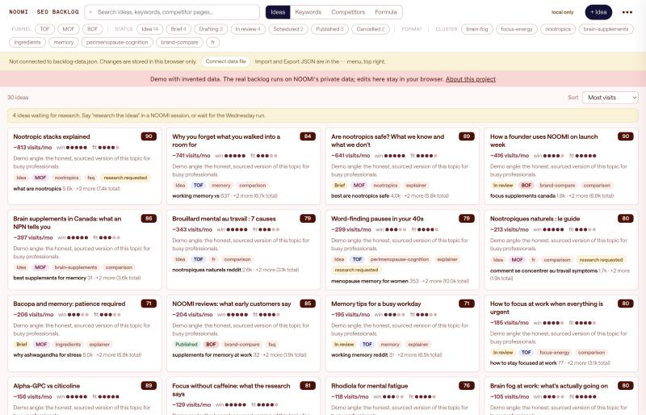

# NOOMI SEO Backlog

**[Open the live demo](https://noodree.github.io/noomi-seo-backlog/)** (invented data)

A single-file web app that holds the SEO content backlog for NOOMI, a Canadian nootropic gummy. It is the shared workspace between me and the AI agents that research, draft and schedule our blog: they write to the same JSON file I review and edit in this interface.

This repo is a public demo. The ideas, keywords and competitor brands are invented; the real backlog runs on private data.

## What it does

- **Ideas board.** One card per article idea, ranked by estimated monthly visits, with funnel stage (top, middle, bottom), cluster, winnability and fit. Open a card to edit the keyword group, outline, FAQ, the angle only we can write, and the hero image spec.
- **Keywords.** Canadian search volumes (Google and Bing), keyword difficulty, trend, intent and a health-claim risk flag. Sort, filter, attach a keyword to an idea or start a new idea from it.
- **Competitors.** Competitor articles that already earn organic traffic, by estimated visits in Canada and the US. Filter by competitor, rate our fit, turn a page into an idea.
- **Formula.** The priority weights (demand, winnability, fit, AI-search visibility), the funnel targets and the live funnel mix of ideas in progress.

## How the agents use it

A weekly scheduled run pulls new keyword data, refreshes competitor pages, proposes ideas, researches the best ones (search results, sources, claims check) and drafts them through a content pipeline. It never publishes: every draft waits for my review. The rules the agents follow are in [docs/agent-contract.md](docs/agent-contract.md).

## How it is built

- One HTML file, no framework, no build step.
- Data lives in a single JSON file. In Chrome, the File System Access API lets the app read and save that file directly; the file handle is kept in IndexedDB so it reconnects on the next visit. Other browsers fall back to local storage with import and export.
- The JSON schema is the contract between the human interface and the agents.
- Keyword and competitor data come from the DataForSEO API in the real version.

Built with Claude Code.

## Run it locally

Open `index.html` through any local web server, for example `python3 -m http.server`, then visit `http://localhost:8000`. The demo data loads automatically. Edits stay in your browser.
